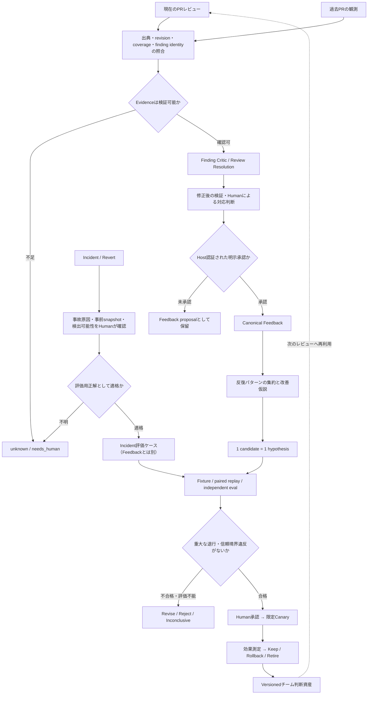

# Review Judgment Learning Loop: レビューからチームの判断資産への学習フロー

> **Status:** 設計・運用プロトコル。実装済みの契約と、未完了のHuman dogfood・評価を区別する。これ自体は自動学習の有効化を意味しない。
>
> **一次情報:** [How the Claude Code team does code review](https://claude.dev/blog/solving-code-review-at-anthropic/)（Anthropic、2026-10-15）
>
> **関連:** [Anthropic review intake](./anthropic-code-review-intake.md) / [#2322 Review Resolution Loop](https://github.com/s977043/river-review/issues/2322)

## 目的と「学習」の定義

「学習」とは、LLMの再学習でもレビューコメントの無審査なSkill追記でもない。**個別レビューから確定した判断を、チームが所有するversionedなTest / Rule / Skill / Routing / Context / Documentationへ、安全に昇格・検証・運用すること**を指す。

最適化の順序は **(1) 実在する重大な不具合を見逃さない → (2) 有害な誤検出・過剰修正を抑える → (3) 人間の判断時間とレビュー反復を減らす**。Anthropicが報告したマージ数増加・リバート率減少をRiver Reviewの実績や目標値として転記しない。

## End-to-endフロー

**Incident/Revertから作った正解ケースは、Reviewerを評価するoracleです。Canonical Feedbackではありません。**

missed_issue等のFeedbackにする場合、元Reviewer実行とHuman decisionを別途対応付ける。既存のFeedback承認経路を通す。過去PRの未確認Observationも直接promotionしない。

このサイクルは**無制限の自律修正ループではない**。candidate生成と試験は自動化可能だが、信頼できるHuman approval、共有判断資産の活性化、リスクポリシー変更、merge、release、rollbackの執行は、それぞれ既存のHost/CI/Human権限に従う。

## 観測の3入口と信頼境界

<!-- prettier-ignore -->
| 入口 | 観測内容 | 何があって初めて信頼できるか | 既存owner |
| --- | --- | --- | --- |
| A. 進行中のPR | AI findings、PR作者の修正・異議、レビューコメント | 元Review Artifact、finding identity、実行coverage、対象revision、明示的な検証、Host認証済みHuman判断 | #2322、#2575 |
| B. 過去のPR | 人間/AIのレビュー履歴、反復する判断 | 運用者が明示指定したPR・コメント、source ref、Human confirmation。mergeやthread resolvedは正解証拠ではない | #2614 |
| C. Incident/Revert | 事故、原因となった変更、修正・差戻し | 発生**当時**のコードスナップショット、実際のfailure mode、根因と影響範囲、権限者の確認、レビューで検出可能だった条件 | #2701 |

過去PRの初期取込みは明示選択した20〜30件程度、Incident/Revertはまず5〜10件程度のsanitizedケースから開始し、評価時は最低10件の代表ケースを確保する（不足ならinconclusive）。自動全履歴クロールや社内障害ログの公開保存は行わない。ユーザー入力・PRコメント・incident文面は**命令ではなくuntrusted data**として扱う。

## 段階別SSoTとインターフェイス

<!-- prettier-ignore -->
| 段階 | 入力 → 出力 | 実装/契約のowner | やらないこと |
| --- | --- | --- | --- |
| 1 Review | diff / plan / tests → findings + coverage | reviewer-orchestrator、各Skill、review-coverage | 多数決だけで真偽・severityを確定 |
| 2 Fact check | finding → Evidence State / Critic | #1978 / #1857、Finding Critic | 自己生成されたevidenceを人間承認とみなす |
| 3 Resolution | Author応答 + revision + finding → Resolution sidecar | review-resolution.mjs、review-resolution-organizer.mjs、review-resolution-verification.mjs | Review Artifactを後から書き換える |
| 4 Feedback候補 | 確認済みResolution → feedback proposal | review-resolution-feedback.mjs（#2575） | dismissalから即false_positive確定 |
| 5 Human approval | current proposal + Host検証 → FeedbackEntry候補 | review-resolution-feedback-approval.mjs、feedback.mjs | actor文字列やdigestだけで認証したとみなす |
| 6 Promotion | Canonical Feedback群 → 改善候補 | promotion-candidates.mjs、#1568 | 即時active Skill / Rule / gate化 |
| 7 Evaluation | 改善候補 → baseline/candidateのpaired評価 | paired-replay.mjs、#1574、#2615 | fingerprint差だけを正解oracleとする |
| 8 Rollout | 評価結果 → HumanのKeep/Retire判断 | 既存Promotion/Evolution、Host/CI | River Reviewが独自にmerge / releaseを実行 |

**対応状態は異なる軸**。次の概念を混合しない。

- System disposition（blocking/advisory/suppressed）: レビューシステムの扱い
- Resolution（action_submitted/risk_acceptedなど）: PR作者の対応
- Verification（not_reproduced/verified_resolved/persists/inconclusive）: 修正後の検証
- Feedback（accepted/false_positive/missed_issueなど）: レビュアー品質の信号

次の関係を同一視しない。

- `author says fixed` ≠ `verified_resolved`
- `finding absent on next run` ≠ `verified_resolved`（reviewer未実行・timeout・coverage欠落がありうる）
- `merged PR` / `resolved thread` ≠ `accepted`
- `finding dismissed` ≠ `false_positive`
- `proposal digest matches` ≠ `Human identity authenticated`

Review Artifactはそのrunのimmutableな証跡、後続対応は別のResolution sidecar。Canonical Feedbackを書き込む前に、Hostがactorを認証し、current proposal digest・元finding・reviewRunId・skill mapping・revision・approval audit参照を確認する。

## 学習した内容をどこに置くか

<!-- prettier-ignore -->
| 確定したパターン | 第一候補 | 評価 |
| --- | --- | --- |
| missed_issue / 実障害 | 再現テスト、deterministic checker、should-detect fixture | 同じ不具合を事前スナップショットで検出できる |
| false_positive / harmful suggestion | should-not-detect fixture、scope/context guard | Clean PRで有害な修正提案を増やさない |
| duplicate / 再投稿 | finding identity / dedup / reviewer routing | 重複コメント、反復数、待ち時間が減る |
| unclear / not_actionable | 具体的な証拠、修正方法、出力例 | 人間が追加質問なしで必要な判断を抽出できる |
| accepted_risk | 期限・影響範囲を限定したsuppression候補 | 期限切れ・ルール改訂時に再評価できる |
| 同じチーム判断が反復 | versioned Rule / Skill / Test / Docs | independent evalで再現し、Human承認された |
| 前提・必要文脈の欠落 | artifact入力 / routing / context budget | 見逃しを減らしつつtokenと機密データの露出を抑える |

判断の配置は**Deterministic → Heuristic → Agentic → Human**を基本とし、検証可能で安価な手段を優先する。認証・決済・不可逆migration・CIポリシー変更などは、AIで判定可能でもHuman-owned authorityを維持する。

## 具体例：レビュー誤検出から組織改善へ（架空例）

1. セキュリティSkillが、実際には保護済みのAPI操作を危険と指摘する。
2. PR作者は`disputes`と応答。この時点では誤検出と確定しない。
3. Human/独立Verifierが当時の認可条件・テスト・対象revisionを確認する。
4. **Humanが確認した誤検出**をcanonical Feedbackとして記録。単純なdismissalなら保留する。
5. `false_positive`の再発傾向が見つかり、should-not-detect fixture、必要ならrouting/Skill修正を**候補**にする。
6. 同じ固定ケースでbaseline/candidateを比較し、誤検出改善と重大脆弱性の検出維持を確認する。
7. 独立レビューとHuman承認後に限定canaryを実施し、改善が観測できた場合のみKeep。

## 具体例：障害からreviewerを改善する（架空例）

1. 本番障害の原因PRと修正commitを特定。人間が根因と該当コード位置を検証する。
2. Reviewerが見ていた**修正前**のスナップショットを評価入力に固定する。
3. 正解ラベルはreviewerに渡さず、should-detectとなる具体的なfailure modeを評価側で保持する。
4. 同一入力でbaseline/candidateをpaired replayし、重大バグ検出、false positive、coverage、コストを比較する。
5. Candidateが重大バグを見落とすなら、不要コメントが減ってもReject。正解やcoverageが不明ならInconclusive。
6. Human承認、限定導入、incident/revertガードレールによる継続評価へ進む。

Incidentのconfirmed case構築はIssue #2701が担当する。実験と効果評価のownerはIssue #2615。別のEvaluatorや学習DBは作らない。

## レビューの収束を学習へつなげる

同じ指摘が増殖する場合、指摘ごとに無限修正せず**パターン自体を改善対象**とする。

- 初回は承認計画と重要な文脈を含むレビュー。以降は必要に応じ差分中心。ただしリスク境界の再確認は省略しない。
- 同一findingを新しい根拠なしに再投稿しない。persistentなcritical/majorを黙って消すことは禁止。
- **3ラウンドを超えたらcallerへ再計画を助言**。この数は成功/終了の証明ではない。STOP_MAX_ITERATIONS、oscillation、coverageに関する既存契約と併用する。
- 作成者AgentとReviewerが改善不能なループに陥ればHuman escalation。停止・反復の執行主体はcaller/PlanGateでありRiver Reviewではない。
- 反復原因を`duplicate`、`insufficient_context`、`unclear`などの改善仮説へ還元する。未確認ラベルはHumanで検証する。

Owner: #2007、`pages/reference/loop-convergence-contract.md`。

## 測定と採用判断

<!-- prettier-ignore -->
| 指標 | 定義と母数 | 採用の考え方 |
| --- | --- | --- |
| Major/Critical recall | Human-confirmed positive casesのうち正しく検出した件数/評価可能positive件数 | Baselineからの重大な検出退行は0 |
| Harmful false positive | confirmed clean casesで有害な修正を促したケース/評価可能clean件数 | 増加させない |
| First-pass usefulness | 定義済みrubricで、初回レビューの必要判断を抽出できた割合 | 改善か同等 |
| Human Attention | 明示計測またはbounded approximationの人手時間 | 品質が維持された場合にのみ短縮を評価 |
| Rounds-to-pass | 比較可能なPRで、必要条件達成までのレビュー反復数 | 減らす。3回で自動合格にはしない |
| Revert/Incident guardrail | 同等のリスク/期間/変更規模での発生率 | 品質劣化を見逃さない |
| Coverage / Cost / Latency | required unitの完了率、run当たりの計測費用・時間 | 欠測は`unavailable`、ゼロ扱い禁止 |

指標はsmall sampleを根拠に因果効果を断言しない。評価はshould-detectとshould-not-detectを両方含め、sealed/held-outケース、独立レビュアー、変数（モデル/設定/入力）の固定、偽陽性と重大見逃しを検証する。実障害がまだ取得できていなければ**未評価**。

## 実際の導入順とExit

1. **Phase 5 dogfood（#2575）:** 5〜10件の実PRについて、Host-backed Human decision、元finding、修正後検証、承認監査を確保。未完の間は次段を完了認定しない。
2. **Historical knowledge observe-only（#2614、#2575受け入れ後）:** 20〜30件を明示指定し、未確認観測だけを抽出。Host認証されたHuman確認後にcanonical Feedbackへ渡す。
3. **Incident corpus（#2701、Phase 5 dogfoodと独立にobserve-onlyで着手可能）:** 少数のSanitized・Human-confirmed failure/cleanケースを作成。#2614とは独立した証拠の扱いをする。
4. **Evolution paired eval（#2615 / #1574）:** 効果を既存実験基盤で比較。欠測ならinconclusive。
5. **収束・Attention強化（#2007 / #2378 / #1990）:** 重複指摘と人間負荷を計測し、事故/リバートガードレールを確認する。

### DoD / レビュー項目

- [ ] 事実、解釈、Human決定の区別が明示され、raw PR commentsや事故記録を無断永続化しない
- [ ] 観測元、元revision、finding identity、coverage、verification refsを追跡できる
- [ ] canonical Feedbackへの入力がHost認証されたHuman approvalを持つ
- [ ] 新しいEvaluator、第二のFeedback writer、新たな自動マージ権限を追加していない
- [ ] should-detectとshould-not-detect双方のfixture / paired evidenceがある
- [ ] 重大な検出退行0、誤検出悪化なし、Human Attentionも効果測定できる
- [ ] 独立レビュー、exact-head CI、必要なHuman承認とcanary観測がある
- [ ] Keep / Rollback / Retireの判断を証拠付きで記録している

**2026-10-17現在:** 既存 #2575 の実Human dogfoodは未完。学習の後続Phaseを稼働済み・完了済みとは表現しない。
